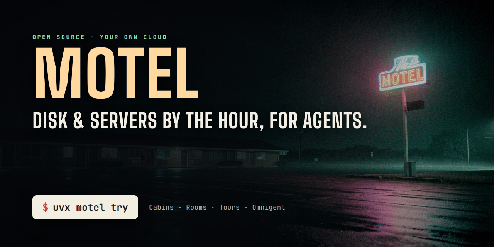
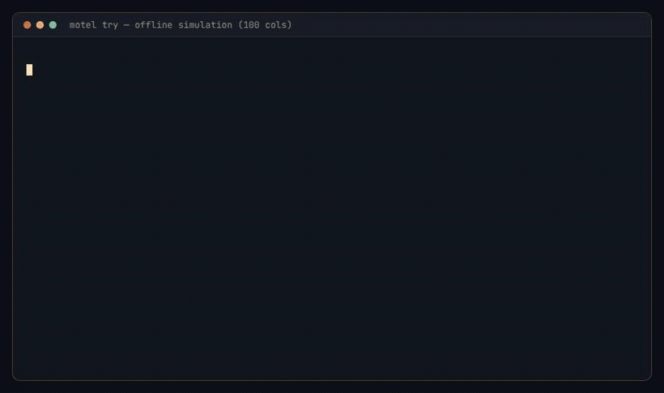

<p align="center"></p>

# motel

**Disk and servers by the hour, for agents.**

One command rents a whole server in your own cloud account, runs the job and deletes the server:
`motel cabin run --for 1h -- make test`. `motel checkin 500G` adds temporary disk to the machine you already have.
Tours run N agents on N fresh servers, with a budget each. It also works as an Omnigent sandbox provider.

```bash
uvx motel try                                       # one full stay: offline, no root, no cloud
sudo uvx --from motel motel install --users $USER   # install the front desk
sudo motel-desk setup hetzner && motel doctor       # connect Hetzner, then check
```

## What are a cabin, a tour and a room?

**Status:** experimental, Hetzner only. The live harness has run rooms, cabins (`ssh-allowlist` mode, one image and
server type), tours of command guests and one Omnigent session against real Hetzner projects. Agent guests that call a
model, `tailscale` mode and every other cloud are tested against fakes only.

| Word | What it is | Status |
|---|---|---|
| **Cabin** | A disposable server in your own cloud project: check in, use over SSH or `cabin run`, check out. Checkout deletes it, with no restore. | Experimental, Hetzner only |
| **Tour** | N bounded agent jobs, each on its own fresh cabin, with a budget each. Commits come back as a branch you review. | Experimental, Hetzner only |
| **Room** | A private `0700` directory on a temporary cloud volume, with a size and a checkout time. | Core feature |
| **Floor** | The shared volume that holds many rooms, attached to your host. A **suite** is a room with a floor of its own. | Core feature |
| **Front desk** | `motel-desk`, the small root-owned helper that holds the token and does every cloud and mount operation. | Core feature |
| **Housekeeping** | The reaper. Runs every 10 minutes: deletes expired cabins, expires rooms, empties lost & found, retires empty floors. | Core feature |
| **No vacancy** | A cap refusal (exit 3). It happens before any cloud call. | Core feature |

<p align="center"></p>

## How do I run a job on a fresh server?

```console
$ motel cabin run --for 1h -- make test     # check in, sync this git checkout, run, check out
```

The server lives in your own Hetzner project. The exit status is the command's. Setup (a dedicated project, a
`[cabins]` table, a token) takes four steps: [first cabin](https://github.com/vicennial/motel/blob/main/docs/cabins.md#first-cabin).

## How do I give an agent 200 GB for an afternoon?

```console
$ D=$(motel checkin 200G --for 6h --task video-render)
motel: room video-render-k3f9 · 200 GB · checkout 2026-03-01T18:40:00Z. Disposable: copy results out before checkout
$ echo "$D"
/mnt/motel/f-3a1c/rooms/video-render-k3f9
$ motel status video-render-k3f9 --json | jq .room.time_left_h
5.9
$ motel extend video-render-k3f9 --for 6h      # late checkout, before a long step
$ motel checkout video-render-k3f9             # done; add --now to delete immediately
```

Stdout carries only the path (or JSON with `--json`); messages go to stderr. Sizes: `200G`, `1T`, or a plain
number of GB. Durations: `90m`, `6h`, `3d`. `motel ls --mine` lists your rooms, `motel restore ROOM` undoes a
checkout, `motel doctor` checks the installation. Full walkthrough: [docs/quickstart.md](https://github.com/vicennial/motel/blob/main/docs/quickstart.md).

## What happens if nobody checks out?

The room never lingers: **active**, then **grace** (6 h, data intact, `extend` revives it), then
**lost & found** (24 h, `motel restore` brings it back), then **purged**. A floor is deleted 15 minutes after its
last room is gone. If a process still has files open in a room, housekeeping waits and reports it. It never
kills anything. See [docs/lifecycle.md](https://github.com/vicennial/motel/blob/main/docs/lifecycle.md).

## Can my agent see my cloud token?

No. Only `motel-desk` reads `/etc/motel/credentials/hetzner.token` (root, `0600`). The unprivileged `motel`
command never sees it. The token travels only from a hidden prompt or a root-owned file to the desk.

motel limits accidents and runaway cost. It does not protect against a hostile root user on the host: anyone with
root can read the token. Rooms are folders on your own host and are not a sandbox. What a cabin or a tour isolates, and
what it does not: [Do I still need a managed sandbox?](#do-i-still-need-a-managed-sandbox)

**What the sudo rule allows.** `motel` reaches the front desk through one `sudo` rule, which lets the users in
`allow_users` run seven verbs as root: `checkin`, `ls`, `status`, `extend`, `checkout`, `restore` and `doctor`.
`setup` and `reap` are not in the rule. The rule pins the verb, not the arguments (it ends in `*`). The desk
itself checks every argument: sizes, durations, task names and room ids must match strict patterns, and it accepts
no paths, provider ids or shell fragments. So a user in `allow_users` can:

- create volumes and rooms up to your caps (defaults: 3 floors, 500 GB per floor, 1000 GB total, EUR 30 a month
  projected), which costs real money;
- extend, check out, delete (`--now`) and restore **their own** rooms;
- list everyone's rooms with `motel ls --all` (ids, owners, sizes, paths).

They cannot read the token, pass a volume id, touch a volume motel did not create, or run `setup` or `reap`.

## What will it never touch?

Only volumes motel created itself. Before every provider write the desk re-reads the volume and requires a
root-owned record of its creation, the labels `managed-by=motel`, `role=floor` and `host=<this server>`, a `motel-`
name, attachment to this server, delete protection off, and an id outside the **never-touch set**. `setup` records
every volume that already exists in the project as never-touch; the set can grow and never shrinks. A volume with
motel labels but no local record is an *orphan*: reported, never adopted. More:
[what motel will never touch](https://github.com/vicennial/motel/blob/main/docs/quickstart.md#what-motel-will-never-touch).

**Known limit.** On Hetzner the token can see the **whole project** of the server, because volumes must live in the
server's project to attach. The guard keeps motel off everything else, but use a project that holds little besides
this host.

## How much does it cost?

You pay the provider for volumes while they exist. Hetzner volumes are roughly EUR 0.05 per GB-month (about
EUR 0.0017 per GB-day). Caps are checked and reserved before any create or resize. The monthly cap is an estimate
from size times price, not a limit the provider enforces. Lost & found keeps billing until the floor is retired.

Hetzner bills servers and volumes **per started hour** from creation (a cabin deleted after five minutes costs a full
hour), so deleting early inside a paid hour saves nothing. motel therefore keeps an idle cabin, and an empty shared floor,
until a release window just before the next billed hour, and shows started hours in its cost estimates. TTLs and explicit
cabin checkouts are never delayed. See [docs/cabins.md](docs/cabins.md#hourly-billing) and
[docs/providers.md](docs/providers.md#how-each-cloud-bills). For a comparison with managed sandboxes, see
[below](#do-i-still-need-a-managed-sandbox).

## Can I try it without a cloud account?

Yes. `uvx motel try` needs nothing: no root, no cloud, no config. For a real run without a cloud, use the local
provider (sparse loop files): `sudo uvx --from motel motel install --provider local && sudo motel-desk setup local`.

## Which clouds work?

| Provider | Status | Notes |
|---|---|---|
| **Hetzner Cloud** | Primary, live-verified ([details](https://github.com/vicennial/motel/blob/main/docs/providers.md)) | Rooms, cabins, tours |
| **local** (loop files) | Works, for testing | Needs root, `losetup`, `mkfs.ext4`. No cloud, no token |
| fake (in memory) | For tests and `motel try` | The reference for writing your own adapter |
| DigitalOcean, Linode, Vultr, Scaleway | **Beta**: tested against fakes only, no live run | API token, typed once at `sudo motel-desk setup <name>` |
| AWS EBS, GCP Persistent Disk, Azure Managed Disks | **Beta**: tested against fakes only, no live run | No token: motel uses the host's instance role, service account or managed identity, so IAM can narrow the credentials |

"Beta" means nobody has run it against a real account yet. Treat the first live run as a supervised test on a scratch
project. [Per-provider pages](https://github.com/vicennial/motel/tree/main/docs/providers) say what is unverified.

## Do I still need a managed sandbox?

Sometimes. For long jobs on a whole machine, a cabin costs much less. For short jobs or hostile code, use a managed sandbox.

**What a cabin is.** A full VM in your own cloud project, with a TTL, a price cap, a dead-man timer and a reaper that
deletes it from outside. You pay the cloud's price, with no markup.

**Cost.** At list prices read on 2026-11-14, a cabin is roughly 5x to 8x cheaper per hour than E2B or Daytona for
sustained work at 8 to 16 vCPU. Sources, method and more sizes:
[docs/cost.md](https://github.com/vicennial/motel/blob/main/docs/cost.md).

| 8 vCPU, 16 GB, one hour | List price | Times Hetzner |
|---|---|---|
| [Hetzner](https://www.hetzner.com/cloud/regular-performance) CPX42 (a cabin) | USD 0.105 | 1x |
| [Daytona](https://www.daytona.io/pricing) (E2B has the same rates, but sells at most 8 vCPU and 8 GiB) | USD 0.66 | 6.3x |
| [Modal](https://modal.com/pricing) Sandboxes | USD 0.95 | 9x |
| [Fly.io](https://docs.fly.io/about/pricing) Machines, performance-8x | USD 0.37 | 3.5x |

Hetzner: the page's hourly "from" price (EUR 0.0953, with IPv4, no VAT) at 1.10 USD per EUR.

**When a managed sandbox is the better choice:**

- Jobs shorter than about 10 minutes. Hetzner bills each started hour, so a 5-minute cabin costs a full hour.
- You need millisecond cold starts. A cabin takes tens of seconds to boot.
- You need memory snapshot, fork or pause.
- You run hostile or untrusted code and want a hardened isolation boundary.
- Your sessions are mostly idle and the service bills active CPU only.
- You want zero operations work: no project, token, firewall or reaper to run.

**Isolation, exactly.**

- A cabin is a separate machine, so the job is off your host. But the guest user has sudo and outbound HTTP and HTTPS,
  so anything you sync to a cabin can be copied out. Sync only what you would hand to its user
  ([cabins: honest limits](https://github.com/vicennial/motel/blob/main/docs/cabins.md#honest-limits)).
- A tour guest is a disposable server, not a sandbox for your secrets beyond what the concierge proxy guarantees: a
  real API key stays with the proxy, but the agent can spend its placeholder up to `budget_usd`, and it can read
  everything in the repository bundle ([tours: what is not protected](https://github.com/vicennial/motel/blob/main/docs/tours.md#what-is-not-protected)).
- Rooms are folders on your own host. They are not a sandbox at all.

**Other tools** (facts from their public docs, read on 2026-11-09):

| | What it is | Where motel differs |
|---|---|---|
| [crabbox](https://crabbox.sh/) | MIT-licensed CLI that leases a remote machine, syncs your repo, runs a command and streams output; many providers; optional broker; TTLs and spend caps. | The closest in spirit: both rent a machine for one command. motel is Hetzner only, and adds a root-owned helper that holds the token, an ownership guard, a reaper that deletes from outside, tours, and rooms for disk. |
| `terraform` / `hcloud` | The full cloud APIs. | They can create the same servers and more, with the token in the agent's reach and nothing that deletes a server the agent forgot. motel is the thin layer: TTLs, a price cap, a reaper, and a token the agent never sees. |

## Can I use it from Claude Code, Codex or Cursor?

<!-- mcp-name: io.github.vicennial/motel -->
Yes: a skill and an MCP server. The skill tells the agent when to check in and the rules (copy results out first,
never retry exit 3 in a loop). The MCP server gives it typed tools.

```bash
npx skills add vicennial/motel               # the skill
claude mcp add motel -- motel mcp            # MCP for Claude Code
```

Codex (`~/.codex/config.toml`):

```toml
[mcp_servers.motel]
command = "motel"
args = ["mcp"]
```

Cursor (`.cursor/mcp.json`): `{ "mcpServers": { "motel": { "command": "motel", "args": ["mcp"] } } }`. Tools:
`motel_checkin`, `motel_list`, `motel_status`, `motel_extend`, `motel_checkout`, `motel_restore`, `motel_doctor`. With `motel mcp --with-tours`: `tour_start`, `tour_status`,
`tour_wait`, `tour_result`, `tour_fetch`, `tour_cancel`.
`motel mcp` runs as the agent's user and calls `motel ... --json`, so it adds no privilege. More:
[docs/agents.md](https://github.com/vicennial/motel/blob/main/docs/agents.md).

## Can my agent run a swarm of agents?

Yes, experimentally. A **tour** runs N bounded agent jobs, each on its own fresh cabin, then deletes every server.
Real API keys never reach a job: a small proxy swaps a per-job placeholder and enforces the budget.

```toml
# tour.toml
defaults = { adapter = "claude", secrets = ["anthropic"], budget_usd = 1.5, ttl = "45m" }
guests = [{ id = "fix-auth", prompt = "Fix the failing tests in tests/auth." },
          { id = "fix-billing", prompt = "Fix the failing tests in tests/billing." }]
```

`motel tour start tour.toml`, then `motel tour wait ID`, then `motel tour fetch ID fix-auth` imports the commits
as a branch you review (never merged for you). The output is untrusted. An operator can opt in to their own Claude login
instead of an API key, with real risks. See [docs/tours.md](https://github.com/vicennial/motel/blob/main/docs/tours.md).

## Can Omnigent run sessions on motel cabins?

Yes, as an optional provider: `uv tool install omnigent --with motel`, then `sandbox.provider: motel` in the Omnigent
server config (`omnigent sandbox create --provider motel` works from an Omnigent source checkout). Each session's host runs on a cabin that has a TTL, a
dead-man timer and your price cap, and is checked out when the session ends. Credentials pass by variable name, not
copied. Experimental; run against a real Hetzner cabin with Omnigent 0.21.0:
[docs/omnigent.md](https://github.com/vicennial/motel/blob/main/docs/omnigent.md).

## FAQ

**Does it back anything up?** No. Rooms are scratch space and the contract is that you can lose all of it. Copy
results out before checkout.

**What if my agent forgets to check out?** The room expires, goes through grace and lost & found, and is purged. You
pay for the volume until its last room is gone and the floor is retired: 15 minutes later, or at the end of the paid
hour on a cloud that bills per started hour.

**Why not just use a bigger disk?** Do, if you always need it. motel is for the day you need 500 GB for three hours.

**Does it work on macOS or Windows?** The front desk needs Linux (mounts, `losetup`, `/proc`). `motel try` is plain
Python (no mounts, no root) and should run on any Unix with Python 3.11+; it is tested on Linux.

**What are the limits?** A room is a folder on your host, not a sandbox. Room size is a packing hint: a room can fill its floor (quotas are
planned). The busy check does not see into overlay or other stacked filesystems whose layers sit inside a room.

## Docs

[Quickstart](https://github.com/vicennial/motel/blob/main/docs/quickstart.md) ·
[Architecture](https://github.com/vicennial/motel/blob/main/docs/architecture.md) ·
[Lifecycle](https://github.com/vicennial/motel/blob/main/docs/lifecycle.md) ·
[Configuration](https://github.com/vicennial/motel/blob/main/docs/configuration.md) ·
[Providers](https://github.com/vicennial/motel/blob/main/docs/providers.md) ·
[Cabins](https://github.com/vicennial/motel/blob/main/docs/cabins.md) ·
[Tours](https://github.com/vicennial/motel/blob/main/docs/tours.md) ·
[Concierge](https://github.com/vicennial/motel/blob/main/docs/concierge.md) ·
[Omnigent](https://github.com/vicennial/motel/blob/main/docs/omnigent.md) ·
[JSON output](https://github.com/vicennial/motel/blob/main/docs/cli-json.md) ·
[For agents](https://github.com/vicennial/motel/blob/main/docs/agents.md) ·
[Changelog](https://github.com/vicennial/motel/blob/main/CHANGELOG.md)

## Contributing

Issues and pull requests are welcome. The ground rules are in [AGENTS.md](https://github.com/vicennial/motel/blob/main/AGENTS.md):
standard library only at runtime, no root or network in tests, fail closed, and no real hostnames, IPs or paths
in the tree.

```bash
uv run --extra dev pytest
uv run --extra dev ruff check .
```

## License

[Apache-2.0](https://github.com/vicennial/motel/blob/main/LICENSE).
