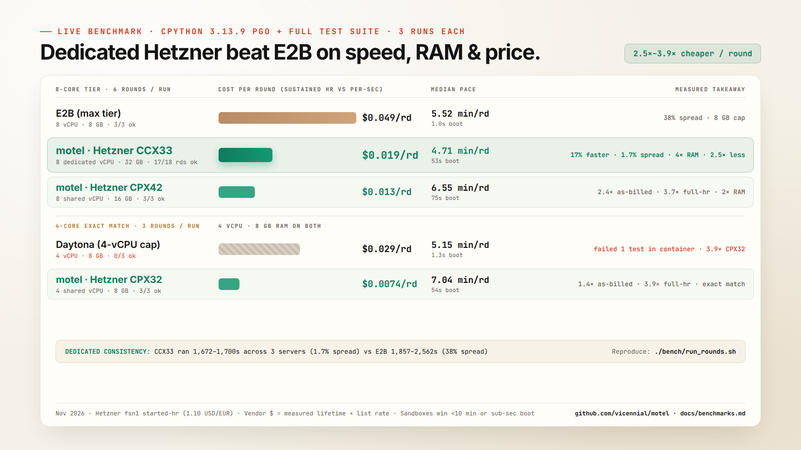

# Benchmarks: method and results

This page says how cabin costs are measured and what is still missing. The list-price comparison is on
[docs/cost.md](cost.md). Everything needed to repeat a run is in [bench/](../bench/README.md).

## What is measured

One fixed workload: build CPython `v3.13.9` (commit `8183fa5e3f78ca6ab862de7fb8b14f3d929421e0`) with
`--enable-optimizations`, then run its full test suite, both at `-j<CPUs>`. The script is
[bench/run_workload.sh](../bench/run_workload.sh). It was chosen because it is CPU bound, deterministic, needs no
network after the fetch step, has a permissive licence and fits in 8 GiB. The reasons are in the
[bench README](../bench/README.md).

Per run, the script records: the CPU count, RAM, CPU model, OS and compiler; the seconds spent on fetch, build and
tests; the build and test exit statuses; and a status of `ok`, `tests_failed` or `build_failed`.

## How a cost is derived

1. Run the workload on a cabin of a known type. The cabin's cost is the type's list price for the started hours the
   run took, from `bench/prices.toml`. motel's own estimate, which also counts boot time, is printed beside it when
   you pass `--billed-eur`.
2. For every vendor, the calculator prices the same vCPU, RAM and minutes at that vendor's published rate under its
   billing rule (per second, per minute, active CPU). This second column is arithmetic, **not** a run on that vendor.
3. A vendor's real cost is measured only in the competitor runs described in
   [bench/competitors.md](../bench/competitors.md), and is read from the vendor's own usage page.

Two figures are reported for each platform: the cost of the run as billed, and the cost of a full hour of the same
machine. The workload is shorter than an hour, so Hetzner's started-hour rule dominates the first figure and the
ratio to a per-second service is small. The second figure is the one that matters for sustained work. Both are
needed.

## What this does not show

- List prices are not what a customer with a discount, a contract or free credits pays.
- A vCPU on one platform is not the same hardware as on another. The CPU model is recorded; it is not controlled.
- One workload is one workload. A job that waits on a network or a model spends less CPU, and cost per CPU-second
  stops being the right measure for it.
- Boot time, snapshots and isolation are real differences that a build-and-test run does not price.

## Results

Measured on **2026-11-14 to 2026-11-15** (commit `42967d7`: CPX42, E2B, Daytona) and **2026-11-23** (commit `83c8ce7` / `v0.1.0`: CCX33, CPX32; workload script unchanged) via [bench/run_rounds.sh](../bench/run_rounds.sh) — repeated rounds of CPython `v3.13.9` PGO build + full test suite. Eight-core runs executed 6 rounds on Hetzner CPX42 (`fsn1`, shared), Hetzner CCX33 (`fsn1`, dedicated), and E2B's maximum offered 8 vCPU / 8 GiB sandbox; four-core runs executed 3 rounds on Hetzner CPX32 (`fsn1`, shared) and Daytona (account-level 4-vCPU cap; all 3 failed one CPython test inside the container).

| Platform | Size | Run | Cold start | Rounds | Whole job (s) | Per round (min) | Status | Amount | Source of the amount |
|---|---|---:|---:|---:|---:|---:|---|---|---|
| Cabin, CCX33 (`fsn1`, ded.) | 8 vCPU / 32 GiB | 1 | 53 s | 6 | 1,700 | 4.72 | `ok` | EUR 0.2227 (~$0.245) | Hetzner started-hour rate (`fsn1` + IPv4, 1 h billed) |
| Cabin, CCX33 (`fsn1`, ded.) | 8 vCPU / 32 GiB | 2 | 52 s | 6 | 1,695 | 4.71 | `ok` | EUR 0.2227 (~$0.245) | Hetzner started-hour rate (`fsn1` + IPv4, 1 h billed) |
| Cabin, CCX33 (`fsn1`, ded.) | 8 vCPU / 32 GiB | 3 | 62 s | 6 | 1,672 | 4.64 | `tests_failed` (5/6 `ok`) | EUR 0.2227 (~$0.245) | Hetzner started-hour rate (`fsn1` + IPv4, 1 h billed) |
| **Cabin, CCX33 median** | **8 vCPU / 32 GiB** | **med** | **53 s** | **6** | **1,695 (28.3 m)** | **4.71** | **2/3 `ok` (17/18 rds)** | **~$0.245 / run ($0.041/round; $0.019/round full-hr)** | **17% faster than E2B · 1.2× cheaper as-billed · 2.5× full-hr** |
| Cabin, CPX42 (`fsn1`, shared) | 8 vCPU / 16 GiB | 1 | 43 s | 6 | 1,416 | 3.93 | `ok` | EUR 0.1122 (~$0.123) | Hetzner started-hour rate (`fsn1` + IPv4, 1 h billed) |
| Cabin, CPX42 (`fsn1`, shared) | 8 vCPU / 16 GiB | 2 | 75 s | 6 | 2,359 | 6.55 | `ok` | EUR 0.1122 (~$0.123) | Hetzner started-hour rate (`fsn1` + IPv4, 1 h billed) |
| Cabin, CPX42 (`fsn1`, shared) | 8 vCPU / 16 GiB | 3 | 75 s | 6 | 2,373 | 6.59 | `ok` | EUR 0.1122 (~$0.123) | Hetzner started-hour rate (`fsn1` + IPv4, 1 h billed) |
| **Cabin, CPX42 median** | **8 vCPU / 16 GiB** | **med** | **75 s** | **6** | **2,359 (39.3 m)** | **6.55** | **3/3 `ok`** | **~$0.123 / run ($0.021/round; $0.013/round full-hr)** | **1 started hour billed** |
| E2B | 8 vCPU / 8 GiB | 1 | 1.01 s | 6 | 1,857 (life 1,904 s) | 5.16 | `ok` | ~$0.282 | List-price calc (`$0.000148/s` × sandbox lifetime) |
| E2B | 8 vCPU / 8 GiB | 2 | 1.60 s | 6 | 2,562 (life 2,583 s) | 7.12 | `ok` | ~$0.382 | List-price calc (`$0.000148/s` × sandbox lifetime) |
| E2B | 8 vCPU / 8 GiB | 3 | 1.04 s | 6 | 1,986 (life 1,993 s) | 5.52 | `ok` | ~$0.295 | List-price calc (`$0.000148/s` × sandbox lifetime) |
| **E2B median** | **8 vCPU / 8 GiB** | **med** | **1.04 s** | **6** | **1,986 (33.1 m)** | **5.52** | **3/3 `ok`** | **~$0.295 / run ($0.049/round)** | **2.4× CPX42 as-billed · 3.7× at full CPX42 hour** |
| Cabin, CPX32 (`fsn1`, shared) | 4 vCPU / 8 GiB | 1 | 53 s | 3 | 1,267 | 7.04 | `ok` | EUR 0.0577 (~$0.063) | Hetzner started-hour rate (`fsn1` + IPv4, 1 h billed) |
| Cabin, CPX32 (`fsn1`, shared) | 4 vCPU / 8 GiB | 2 | 75 s | 3 | 1,882 | 10.46 | `ok` | EUR 0.0577 (~$0.063) | Hetzner started-hour rate (`fsn1` + IPv4, 1 h billed) |
| Cabin, CPX32 (`fsn1`, shared) | 4 vCPU / 8 GiB | 3 | 54 s | 3 | 1,239 | 6.88 | `ok` | EUR 0.0577 (~$0.063) | Hetzner started-hour rate (`fsn1` + IPv4, 1 h billed) |
| **Cabin, CPX32 median** | **4 vCPU / 8 GiB** | **med** | **54 s** | **3** | **1,267 (21.1 m)** | **7.04** | **3/3 `ok`** | **~$0.063 / run ($0.021/round; $0.0074/round full-hr)** | **1.4× cheaper than Daytona as-billed · 3.9× full-hr** |
| Daytona (4-vCPU cap) | 4 vCPU / 8 GiB | 1 | 1.26 s | 3 | 935 (life 949 s) | 5.19 | `tests_failed` | ~$0.087 | List-price calc (`$0.000092/s` × sandbox lifetime) |
| Daytona (4-vCPU cap) | 4 vCPU / 8 GiB | 2 | 1.82 s | 3 | 927 (life 949 s) | 5.15 | `tests_failed` | ~$0.087 | List-price calc (`$0.000092/s` × sandbox lifetime) |
| Daytona (4-vCPU cap) | 4 vCPU / 8 GiB | 3 | 0.99 s | 3 | 917 (life 949 s) | 5.09 | `tests_failed` | ~$0.087 | List-price calc (`$0.000092/s` × sandbox lifetime) |
| **Daytona median** | **4 vCPU / 8 GiB** | **med** | **1.26 s** | **3** | **927 (15.4 m)** | **5.15** | **0/3 `ok`** | **~$0.087 / run ($0.029/round)** | **Faster per round, 0/3 `ok`, 3.9× CPX32 at full hour** |

**Hardware and notes:**
- **CPU models recorded:** Cabin CCX33: `AMD EPYC-Milan Processor` (dedicated cores — `<2%` spread across 3 separate servers: `1,672–1,700 s`, beating E2B's `1,857–2,562 s` median speed and `38%` spread with 4× the RAM); Cabin CPX42 and CPX32: `AMD EPYC-Genoa Processor` (shared cores — noisy-neighbor variance visible on CPX42 runs 2–3 and CPX32 run 2); E2B: `Intel(R) Xeon(R) Processor @ 2.60GHz`; Daytona: `AMD EPYC 9J45 128-Core Processor`.
- **Vendor billing source:** E2B and Daytona amounts above are list-price calculations from driver-measured sandbox lifetime seconds (`bench/prices.toml`, read 2026-11-14); vendor dashboard invoice reconciliation has not been verified yet.
- **Failed / aborted attempts:** One initial 1-round CPX42 cabin run (`7.3 m`, `ok`) was too short to fill an hour and replaced with the 6-round harness; two initial vendor attempts failed due to a bug in the local benchmark driver (missing `--jobs` override inside containers reporting host cores) and were aborted, deleted and re-run cleanly; on 2026-11-23, launching two CCX33 cabins concurrently alongside active CI cabins hit Hetzner's project `resource_limit_exceeded` on run 3, which was re-run solo; round 1 of CCX33 run 3 had one CPython test failure (`exit 2`, rounds 2–6 all `ok`) and is published as recorded per [competitors.md](../bench/competitors.md).
